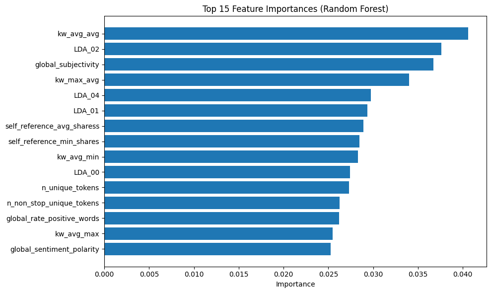
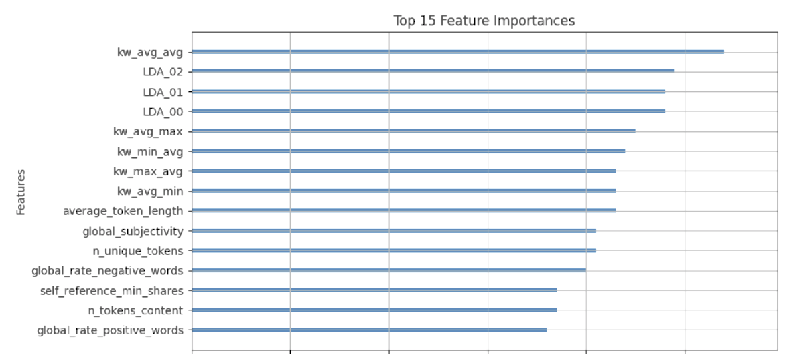

# Online News Popularity Prediction

**Pattern Recognition · undergraduate team project · tabular binary classification**

Predicting article popularity from content metadata, sentiment, keyword statistics, and topic features. The course dataset is derived from UCI Online News Popularity; the original project describes popularity as more than 1,400 shares. The supplied `y` labels are used directly in the code.

**Start here:** [Project report](docs/report.pdf) · [Final course notebook](final%20code/code.ipynb) · [Experiment evidence](docs/experiments.md) · [Reproduction guide](docs/reproduction.md)

## Project at a glance

| Item | Description |
|---|---|
| Task | Predict a binary popularity label and class probability |
| Course training data | 22,200 rows, evidenced by the final notebook split: 16,650 + 5,550 |
| Models explored | Random Forest and XGBoost |
| Evaluation | Accuracy, F1, ROC AUC; course score is their arithmetic mean |
| Team | Yunwoo Choi, Seojeong Cho, Ingyeong Yang, Jiwon Kang |
| Current reproducibility | Original data absent; saved outputs can be inspected, historical training cannot yet be rerun |

## Recorded experiments

These are **historical notebook outputs**, not newly reproduced scores or a controlled head-to-head comparison. Different preprocessing and split configurations were used.

| Experiment | Accuracy | F1 | ROC AUC | Mean | Threshold |
|---|---:|---:|---:|---:|---:|
| Random Forest, saved validation run | 0.6788 | 0.6846 | 0.7520 | 0.7051 | 0.48 |
| XGBoost, final course notebook | 0.6587 | 0.7001 | 0.7243 | 0.6944 | 0.414 |

The Random Forest notebook uses an 80/20 split with seed 42 after preprocessing; the final XGBoost notebook uses a 75/25 split with seed 100. These numbers alone do not establish which model generalizes better. [Read the experiment conditions and limitations](docs/experiments.md).

## Approach

1. Inspect missing values and feature groups.
2. Apply feature-dependent imputation and encode channel/weekday categories.
3. Explore tree ensembles with cross-validation and threshold changes.
4. Inspect feature importance and discuss limitations.

The final course pipeline also clips numerical values at the 1st/99th percentiles. Some historical preprocessing is fitted before the validation split; this needs correction in a rerun.

## Jiwon Kang's contribution

Contributed to missing-value treatment and categorical encoding, analysis of selected features, performance comparison, and preparation of explanations for the team report. Team-level model results are reported above; ownership of every modeling experiment is not attributed to one member.

## Code and materials

| Path | Purpose |
|---|---|
| `final code/code.ipynb` | Original final submission workflow and saved outputs |
| `results/Random_Forest_Classfier.ipynb` | Historical Random Forest experiments |
| `results/XGBoost.ipynb` | Historical XGBoost experiments |
| `scripts/train_baseline.py` | New baseline with training-only preprocessing and explicit run metadata |
| `docs/report.pdf` | Original course report |
| `results/figures/` | Existing feature-importance figures |

### New baseline

After restoring the original course `train.csv`, run from the repository root:

```bash
python -m pip install -r requirements.txt
python scripts/train_baseline.py --train data/train.csv
```

The script uses a stratified 80/20 split, seed 42, a fixed Random Forest configuration, and threshold 0.5. It writes metrics and validation predictions under `results/new-baseline/`. This is a new, simplified baseline; it does not reproduce the historical score. Only synthetic smoke checks have been performed during repository maintenance.

## Interpretation and next steps

- Recover the original course data and verify the exact label rule against the assignment.
- Compare models on the same split, fitting preprocessing inside each training fold.
- Select hyperparameters and thresholds without using the final evaluation partition.
- Treat feature importance as model association, not a causal explanation of sharing behavior.



